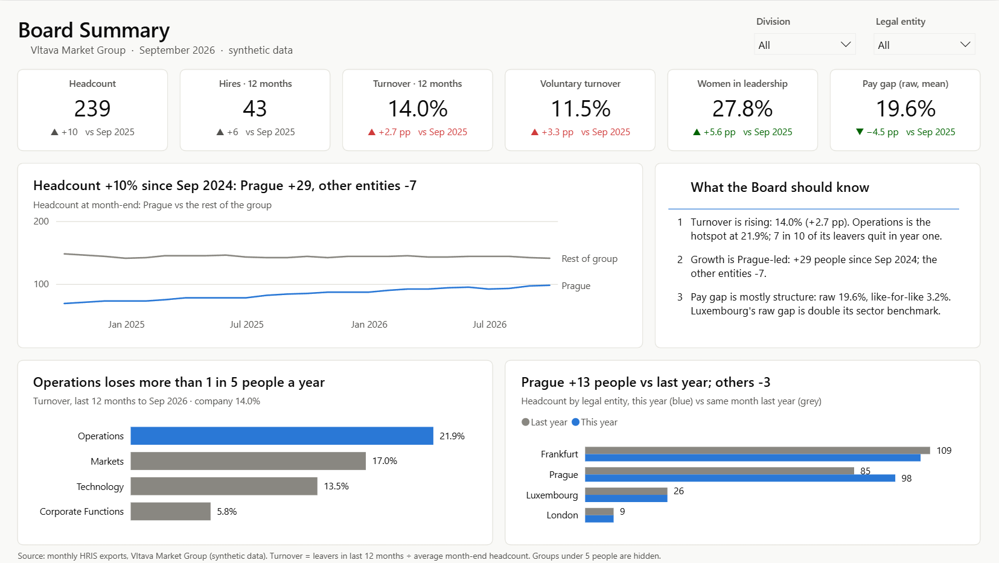
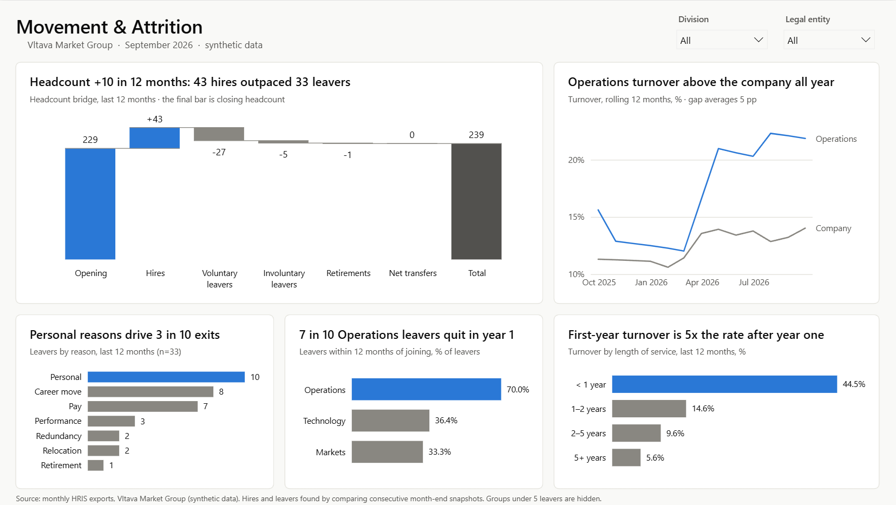
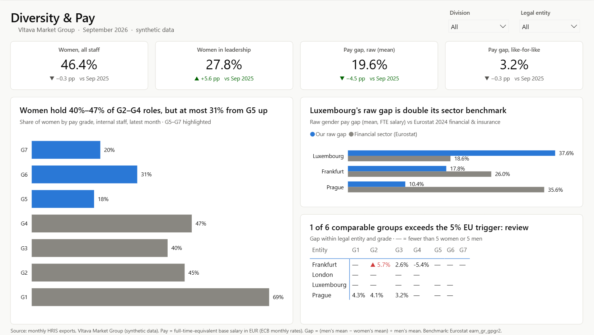

# People Analytics portfolio

**Kamal Salman** · [LinkedIn](https://www.linkedin.com/in/kamal-salman-091411244/) · Prague

Four small, working demos of what a People Analytics team does every month: automate the HR report, brief the Board,
validate a reorganisation, and resolve a "the numbers don't match" ticket. Plus the visualization standards behind them.



> **Data:** *Vltava Market Group* is fictional and every person in it is synthetic (generated with Faker).
> The only real data is public: Eurostat gender pay gaps and ECB exchange rates.

## The demos

| | Demo | What it shows | Start here |
|---|---|---|---|
| **D1** | Refresh, don't rebuild | 25 monthly HRIS exports → Power Query → one model. A new month is one file and one click. 8 data-quality rules with documented actions. | [power_query/](powerbi/power_query) · [Data Quality page](powerbi/screenshots/4_data_quality.png) |
| **D2** | Board Pack (Power BI) | 4 pages, 91 DAX measures, chart titles computed from the data, real Eurostat benchmark, row-level security, n<5 suppression. | [Board_Pack.pbip](powerbi/README.md) · [screenshots](powerbi/screenshots) |
| **D3** | Reorg in a box | Excel mapping template that flags errors as HRBPs type; Python validation of spans, layers and headcount; a one-page memo. | [reorg_memo.md](docs/reorg_memo.md) · [template](excel/reorg_mapping_template.xlsx) |
| **D4** | Ticket #4711 | "My list says 50, the dashboard says 47." DuckDB SQL finds the three reasons; the KPI catalog stops it recurring. | [ticket_case.md](docs/ticket_case.md) · [SQL](sql/ticket_4711.sql) · [KPI catalog](docs/kpi_catalog.md) |
| | Style guide | Message titles, one accent colour, IBCS notation, a palette tested for colour blindness, accessibility checklist. | [viz_style_guide.md](docs/viz_style_guide.md) |

A short tour of all five, with talking points and a 5-minute demo script: **[docs/OVERVIEW.md](docs/OVERVIEW.md)**.
Everything in one PDF: **[portfolio/Kamal_Salman_People_Analytics_Portfolio.pdf](portfolio/Kamal_Salman_People_Analytics_Portfolio.pdf)**.

<table><tr>
<td></td>
<td></td>
</tr></table>

## What the data says (September 2026)
- **Turnover is rising:** 14.0% over 12 months, +2.7 pp on last year. Operations is the hotspot at 21.9%, and 7 in 10 of its leavers quit in their first year.
- **Growth is Prague-led:** +29 people in two years; the other entities −7.
- **Pay gap is mostly structure:** raw 19.6%, like-for-like 3.2%. Luxembourg's raw gap is double its Eurostat sector benchmark.

## How it's tested
| Check | Result |
|---|---|
| Data-quality rules vs 19 planted errors (answer key) | 19 found, 0 false alarms |
| Headcount bridge: opening + hires − leavers ± transfers = closing | closes every month and division |
| Power BI measures vs an independent pandas calculation | **240 of 240** values match |
| Reorg: first mapping vs answer key · final mapping vs the July HRIS export | 6 of 6 issues · 97 of 97 people |
| Ticket #4711 reconciliation | 47 + 3 = 50, nothing unexplained |
| Excel template calculated by Excel itself | all checks fire, 0 formula errors |

## Run it
Windows, Python 3.11+, Power BI Desktop (September 2026 or later) to open the report.
```bash
pip install -r requirements.txt
python src/run_all.py            # rebuilds everything (add --offline to skip the Eurostat/ECB download)
```
Then open `powerbi/Board_Pack.pbip` and click **Refresh now**. To check Power BI against the reference numbers:
```bash
powershell -ExecutionPolicy Bypass -File src/check_powerbi_numbers.ps1
python src/compare_powerbi.py
```

## Repository map
```
data/exports/            25 monthly HRIS exports (synthetic)        data/external/   Eurostat + ECB (real)
data/reference/          answer keys and reference KPIs              data/reorg/      D3 inputs and results
data/ticket/             the HRBP's list for Ticket #4711            data/VMG_datasets_overview.xlsx  every dataset, one workbook
powerbi/                 Board_Pack.pbip, Power Query, theme, backgrounds, screenshots
excel/                   reorg mapping template
sql/                     Ticket #4711 investigation (DuckDB)
src/                     every script; run_all.py runs them in order
docs/                    overview, style guide, KPI catalog, governance, reorg memo, ticket case
portfolio/               PDF, static page renders, reorg chart
```

## Tools
Power BI (Power Query M, DAX, TMDL/PBIR project format) · Excel (XLOOKUP, data validation, conditional formatting) ·
SQL (DuckDB) · Python (pandas, matplotlib, openpyxl, reportlab)
