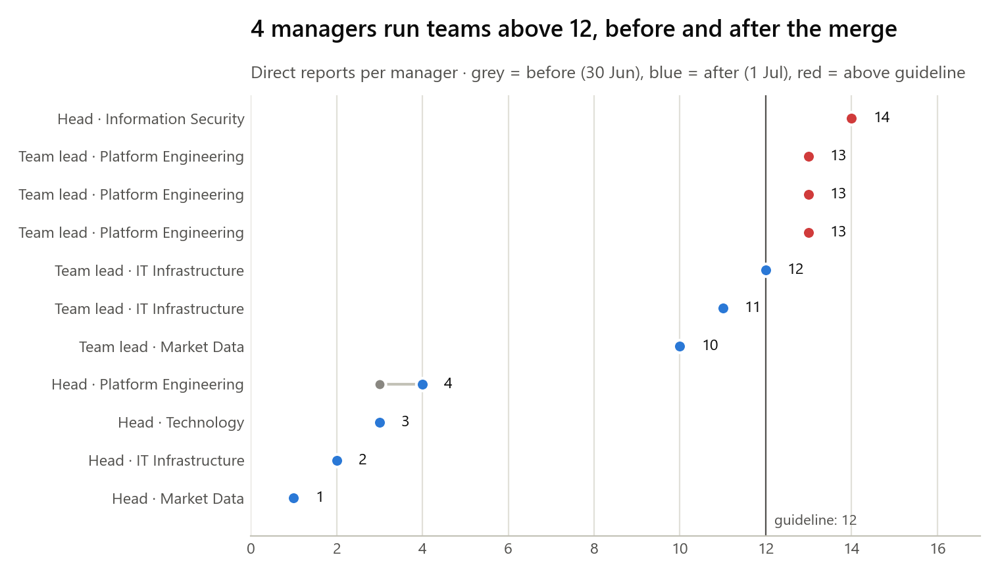
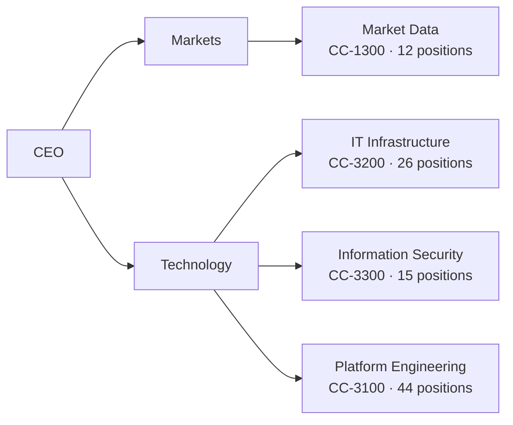
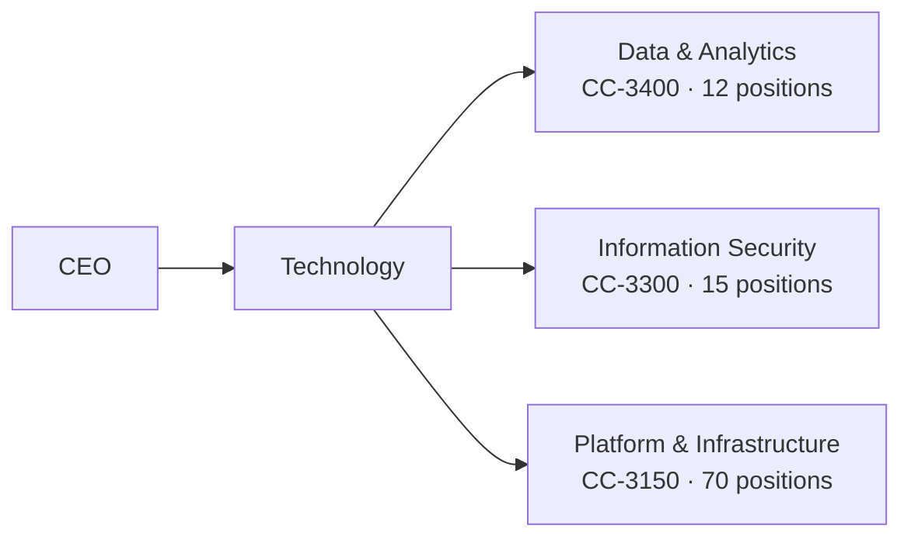

# Q3 2026 Technology reorganisation: mapping validation

*Vltava Market Group People Analytics · prepared 24 June 2026 · go-live 1 July 2026 · synthetic data*

## Summary
- **The first HRBP mapping could not go live:** 6 blocking issues, including a whole unit missing
  (15 positions would have dropped out of reporting).
- **The corrected mapping (v2) passes every check:** 97 positions before, 97 after, every unit mapped, every cost center unique.
- **Three design points for the Head of Technology:** 4 spans above 12,
  one manager with a single report, and the merge adds a management layer (for IT Infrastructure, 5 → 6).
- **After go-live the HRIS matches the mapping:** 97 of 97 people still employed in July sit in exactly the unit the mapping predicted.

## What changes
- *Market Data* moves from Markets to Technology and becomes **Data & Analytics** (CC-3400).
- *Platform Engineering* and *IT Infrastructure* merge into **Platform & Infrastructure** (CC-3150).
  The Head of IT Infrastructure becomes deputy and reports to the Head of Platform & Infrastructure.
- *Information Security* is unchanged.

## Blocking issues found in the first submission (v1)
| Rule | Check | Unit | Finding |
|---|---|---|---|
| R01 | Unit not mapped | Information Security | 15 positions would have no unit after go-live |
| R04 | Unit head not an active employee | Platform Engineering | Person 100157 left before June 2026 |
| R02 | New unit not in target structure | IT Infrastructure | 'Platform & Infrastucture' (typo) |
| R03 | Cost center used by two new units | Market Data | CC-3150 already belongs to Platform & Infrastructure |
| R05 | Effective date differs from the programme | Market Data | 2026-08-01 instead of 2026-07-01 |
| R06 | Headcount does not reconcile | (all) | 97 before, 82 after |

All six were fixed in v2 with the HRBPs before the 26 June cut-off.

## Structure before and after (v2)
| Measure | Before (30 Jun) | After (1 Jul) |
|---|---|---|
| Positions | 97 | 97 |
| Units | 4 | 3 |
| Managers | 11 | 11 |
| Average span | 8.6 | 8.7 |
| Widest span | 14 | 14 |
| Spans above 12 | 4 | 4 |
| Single-report managers | 1 | 1 |
| Layers (CEO to front line) | 5 | 6 |

## Design notes (not errors: for the business to decide)
| Rule | Check | Finding |
|---|---|---|
| S01 | Span above 12 | Head of Information Security (100292) has 14 direct reports |
| S01 | Span above 12 | Team Lead, Platform Engineering (100102) has 13 direct reports |
| S01 | Span above 12 | Team Lead, Platform Engineering (100103) has 13 direct reports |
| S01 | Span above 12 | Team Lead, Platform Engineering (100104) has 13 direct reports |
| S02 | Manager with a single report | Head of Market Data (100047) has 1 direct report |
| S03 | Unit gains a management layer | IT Infrastructure staff go from 5 to 6 layers below the CEO, now inside Platform & Infrastructure |

**Recommendations**
1. Let the IT Infrastructure team leads report directly to the Head of Platform & Infrastructure, removing the extra layer.
2. In Data & Analytics the head manages a single team lead: merge the two roles or widen the head's remit.
3. Split the widest teams (13–14 direct reports) when the open roles are filled.

## Org charts (unit level)
**Before, 30 June 2026**

**After, 1 July 2026**

## How this was checked
`src/reorg_validate.py` applies each mapping to the 30 June position list and runs six blocking checks and three design
checks. The first submission must trigger exactly the issues in `data/reorg/expected_exceptions_v1.csv`. The HRBPs fill in
the mapping in `excel/reorg_mapping_template.xlsx`, which flags most of the blocking issues as they type.
